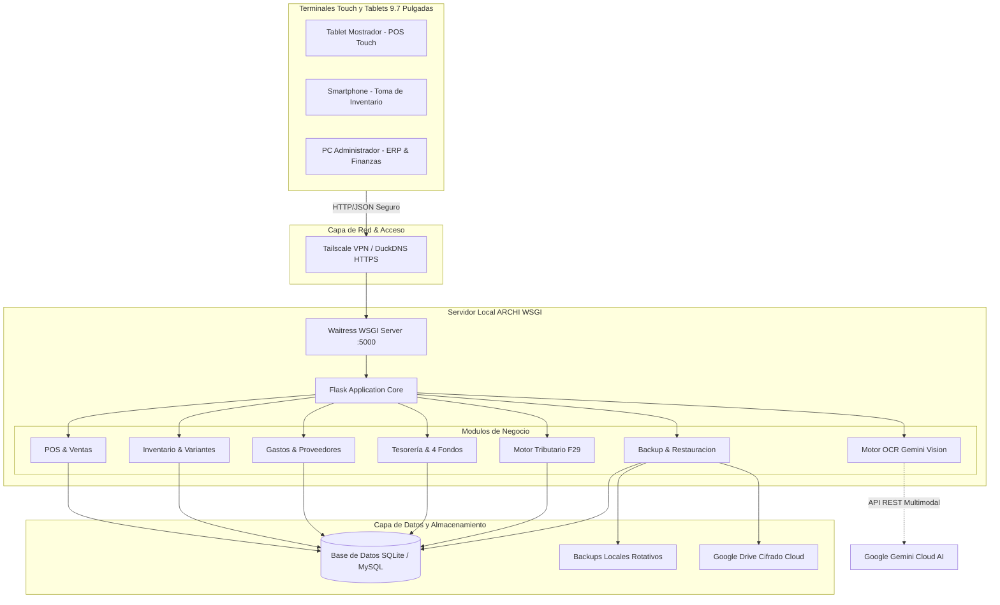

# ARCHI POS & ERP Empresarial

> Sistema Integral de Punto de Venta, Inteligencia de Inventario Multi-Sucursal y Asesor Financiero Automatizado para Retail (Régimen Pro Pyme 14 D3 - SII Chile).

[](https://www.python.org/)
[](https://flask.palletsprojects.com/)
[](https://www.sqlite.org/)
[](https://ai.google.dev/)
[-F7DF1E?style=flat&logo=javascript&logoColor=black)](https://developer.mozilla.org/)
[](https://github.com/)
[](https://github.com/)
[](LICENSE)

---

## 1. Propuesta de Valor y Enfoque Comercial

### El Problema del Retail y las Pymes en Chile
La mayoría de los sistemas de punto de venta (POS) tradicionales se limitan a ser calculadoras de caja registradoras con emisión de tickets. Los dueños de negocios en Chile enfrentan tres problemas críticos que destruyen su rentabilidad:
1. **Ceguera Tributaria:** Incapacidad de prever el pago mensual de impuestos (Formulario 29: IVA neto + PPM), lo que provoca multas por mora ante el SII y crisis repentinas de liquidez al día 20 de cada mes.
2. **Capital Atrapado en Bodega:** Carencia de visibilidad sobre qué productos concentran el 80% de las ventas frente a aquellos que representan capital inmovilizado y obsolescencia.
3. **Desorden en la Tesorería:** Mezcla constante de los ingresos operativos con el sueldo del dueño, los arriendos y el dinero de reinversión en stock.

### La Solución: ARCHI POS & ERP
ARCHI no es solo un software de facturación; es un **asesor financiero y operativo automatizado**. Transforma cada venta en datos estratégicos en tiempo real, permitiendo a empresas del **Régimen Pro Pyme (Art. 14 D3)** tomar decisiones basadas en números precisos.

### Retorno de Inversión (ROI) Comprobado
- **Reducción del 85% en tiempo de cuadratura:** Cierre de caja en menos de 2 minutos mediante conciliación asistida por visión artificial (OCR multimodal de vouchers de tarjetas).
- **Disminución del 40% en quiebres de inventario:** Monitoreo dinámico del ritmo de venta diaria (Run Rate) y alertas automáticas de reposición antes de agotar existencias.
- **Previsibilidad Tributaria Total (F29):** Cálculo automático del IVA débito vs. crédito fiscal y cálculo exacto del PPM a reservar, evitando sorpresas al cierre contable.
- **Disciplinamiento Financiero Automático:** División algorítmica de la recaudación mediante la regla de los 4 Fondos de Capital.

---

## 2. Core Features (Capacidades Principales)

### A. Punto de Venta Touch de Ultra Baja Latencia
- **Diseño Ergonómico para Tablets de 9.7":** Interfaz táctil de alto contraste (estética Tesla/Orion) construida en Vanilla JavaScript sin sobrecarga de frameworks, garantizando 60 FPS estables y cero latencia de toque.
- **Soporte Multi-Método de Pago:** Débito, Crédito, Efectivo (con cálculo de vuelto dinámico), Transferencias Bancarias y Pagos Divididos/Mixtos en una sola transacción.
- **Gestión Avanzada de Variantes:** Matriz completa de tallas y atributos por producto con selector modal touch-friendly de toque completo.
- **Cuadratura y Cierre de Caja con IA:** Captura fotográfica directa de los vouchers emitidos por terminales de pago (Transbank, Getnet, Redelcom, Mercado Pago) con extracción automática de totales mediante Google Gemini Vision OCR.

### B. Inteligencia Financiera y Motor Tributario (SII Chile)
- **Simulador en Tiempo Real del Formulario 29 (F29):** Proyección mensual de la obligación tributaria neta considerando el débito fiscal de ventas y el crédito fiscal de compras a proveedores.
- **Gestión de Tratamientos Tributarios:** Clasificación estricta de egresos en:
  - *Factura Afecta (Recupera IVA 19%)*
  - *Factura Exenta / Boleta de Honorarios (Gasto Renta)*
  - *Gastos Rechazados*
- **Tasa de PPM Parametrizable:** Cálculo del Pago Provisional Mensual según los regímenes tributarios vigentes en Chile.
- **Escudo Fiscal y Simulador de Medios de Pago:** Proyección del costo financiero y tributario derivado de comisiones de adquirencia versus pago en efectivo o transferencia.

### C. Asignación de Capital: Metodología de los 4 Fondos
El sistema distribuye algorítmicamente la tesorería acumulada para garantizar solvencia perpetua:
1. **Fondo de Remuneraciones:** Reserva programada para sueldos del personal y retiro del emprendedor.
2. **Fondo de Reinversión de Stock:** Capital protegido exclusivamente para la recompra de mercadería crítica.
3. **Fondo de Gastos Fijos (Colchón Operativo):** Acumulación prorrateada para arriendos, gastos comunes, energía y conectividad.
4. **Fondo de Reserva / Imprevistos:** Fondo de seguridad para contingencias operacionales.
- **Conciliación de Pozo Bancario:** Arqueo periódico de cuentas bancarias contrastando el saldo real con los saldos teóricos del sistema.

### D. Inteligencia de Inventario Multi-Sucursal
- **Análisis ABC (Pareto 80/20):** Clasificación algorítmica del catálogo en productos Clase A (alto impacto), Clase B (rotación media) y Clase C (bajo impacto/riesgo de obsolescencia).
- **Detección de Capital Inmovilizado:** Identificación de stock sin rotación para liquidación estratégica.
- **Plan MRP de Reabastecimiento Inter-Sucursales:**
  - Cálculo de la velocidad de consumo diario (Run Rate).
  - Cálculo de días de cobertura restante.
  - Punto de Reorden (ROP) y Stock de Seguridad ajustado al tiempo de entrega (Lead Time) del proveedor.
- **Generación Vectorial de Códigos EAN-13 GS1:** Generador de etiquetas PDF en formato Carta/A4 a 300 DPI (24 etiquetas por hoja) con prefijo oficial de Chile (780), legibles con lectores ópticos láser y de cámara.

---

## 3. Arquitectura Técnica

### Stack Tecnológico

| Capa | Tecnología | Justificación Técnica |
| :--- | :--- | :--- |
| **Frontend** | HTML5 Semántico, CSS3 Vanilla, JavaScript Modular (ES6+) | Eliminación de bundle overhead. Latencia cero en renderizado de componentes touch para tablets de recursos moderados. |
| **Backend** | Python 3.11+, Flask Framework (Blueprints) | Arquitectura modular desacoplada por dominios de negocio. Mantenimiento y extensibilidad simplificados. |
| **Base de Datos** | SQLite (Modo WAL) / MySQL 8.0+ | Transacciones ACID atómicas con bloqueos optimistas para evitar condiciones de carrera en ventas e inventario. |
| **Visión / IA** | Google Gemini 1.5 / 2.0 Flash Vision API | Extracción multimodal estructurada de comprobantes térmicos de pago con tolerancia a arrugas y baja luz. |
| **Reportes / PDF** | ReportLab 4.x Vectorial | Generación nativa de PDFs (etiquetas de código de barras 300 DPI y reportes financieros) sin dependencias headless. |
| **Servidor WSGI** | Waitress (Producción Windows/Linux) | Servidor HTTP WSGI multihilo puro de alto rendimiento sin requerir Nginx inverso obligatorio para despliegues locales. |

### Diagrama de Arquitectura de la Solución



### Principales Endpoints de la API REST

| Método | Endpoint | Descripción | Perfil Requerido |
| :--- | :--- | :--- | :--- |
| `POST` | `/api/sales` | Registra una nueva transacción de venta con desglose de pago | Cajero / Admin |
| `GET` | `/api/sales/daily-summary` | Obtiene el total consolidado del día y arqueo de caja | Cajero / Admin |
| `GET` | `/api/products` | Consulta el catálogo con variantes y stock por sucursal | Cajero / Admin |
| `POST` | `/api/products` | Crea o actualiza un producto y sus variantes | Administrador |
| `POST` | `/api/transfers` | Registra un traspaso atómico de stock entre sucursales | Administrador |
| `GET` | `/api/suppliers/expenses` | Consulta los gastos operativos del mes por categoría | Administrador |
| `POST` | `/api/suppliers/expenses` | Registra un egreso operacional o compra de stock | Administrador |
| `GET` | `/api/taxes/f29-summary` | Obtiene la simulación tributaria del F29 del periodo | Administrador |
| `POST` | `/api/ocr/analyze-voucher` | Procesa voucher de pago con IA para cuadratura de caja | Cajero / Admin |
| `POST` | `/api/backup/create` | Genera copia de seguridad física de la base de datos | Administrador |

---

## 4. Instalación y Puesta en Marcha

### Prerrequisitos de Sistema
- **Sistema Operativo:** Linux (Ubuntu 22.04+ LTS recomendado), Windows 10/11 o macOS.
- **Python:** Versión **3.11** o superior.
- **Hardware Mínimo Recomendado:** 4 GB de RAM, Procesador Dual-Core 2.0 GHz, 10 GB de almacenamiento SSD.
- **Terminales:** Cualquier tablet con navegador web moderno (Safari en iOS 14+, Chrome en Android 10+).

### 1. Clonar el Repositorio y Configurar Entorno Virtual
```bash
# Clonar repositorio
git clone https://github.com/tu-organizacion/gestion-pos.git
cd gestion-pos

# Crear entorno virtual
python -m venv venv

# Activar entorno virtual
# En Windows:
venv\Scripts\activate
# En Linux/macOS:
source venv/bin/activate

# Instalar dependencias
pip install -r requirements.txt
```

### 2. Configuración de Variables de Entorno (`.env`)
Crear un archivo `.env` en la raíz del proyecto tomando como referencia la siguiente plantilla:

| Variable | Tipo | Valor por Defecto | Descripción |
| :--- | :--- | :--- | :--- |
| `FLASK_ENV` | String | `production` | Modo de ejecución (`development` o `production`) |
| `FLASK_SECRET_KEY` | String | *(Generar aleatorio)* | Llave criptográfica para firmas de sesión de usuario |
| `PORT` | Entero | `5000` | Puerto TCP de escucha del servidor |
| `DB_TYPE` | String | `sqlite` | Motor de base de datos (`sqlite` o `mysql`) |
| `DB_PATH` | String | `inventory_sales.db` | Ruta del archivo de base de datos SQLite |
| `DB_HOST` | String | `localhost` | Host de conexión MySQL (si `DB_TYPE=mysql`) |
| `DB_PORT` | Entero | `3306` | Puerto de conexión MySQL |
| `DB_USER` | String | `archi_user` | Usuario de base de datos MySQL |
| `DB_PASSWORD` | String | `tu_password` | Contraseña de usuario MySQL |
| `DB_NAME` | String | `archi_db` | Nombre del esquema en MySQL |
| `GEMINI_API_KEY` | String | *(Opcional)* | Clave de API de Google Gemini para módulo OCR |
| `ADMIN_INITIAL_USERNAME` | String | `admin` | Usuario administrador creado en el primer inicio |
| `ADMIN_INITIAL_PASSWORD` | String | `Admin2026!` | Contraseña inicial (obligatorio cambiar tras login) |

### 3. Ejecutar el Servidor de Aplicación

#### En Entorno Windows:
Hacer doble clic en `run.bat` o ejecutar:
```cmd
run.bat
```

#### En Entorno Linux / Servidor Local:
```bash
python app.py
```
El servidor inicializará las 14 migraciones relacionales automáticamente y quedará disponible en `http://localhost:5000`.

### 4. Configuración para Tablets (PWA)
1. Conectar la tablet a la misma red local Wi-Fi o mediante VPN segura (**Tailscale**).
2. Abrir el navegador en la tablet e ingresar la IP local del servidor (ejemplo: `http://192.168.1.100:5000`).
3. Instalar como aplicación web nativa de pantalla completa:
   - **En iPad (Safari):** Pulsar botón Compartir > **"Agregar a pantalla de inicio"**.
   - **En Android (Chrome):** Menú de opciones (tres puntos) > **"Instalar aplicación"**.

---

### Modelo De Soporte Para Tablet En 3D

---


---

## 5. Capturas de Pantalla del Sistema

Las siguientes vistas representan los módulos clave de la interfaz táctil:


---

### Terminal Punto de Venta Touch (POS)

---


---


---


---


---

### Dashboard Financiero y Asignación de 4 Fondos
---


---


---
### Analisis & Metricas

---


---


---


---


---


---


---


### Inteligencia de Inventario y Matriz ABC (Pareto)
---


---


---

### Control de Gastos y Visión Semestral


---


---


---


---


---
### Impuestos & F29

---


---


---


---
### Configuración del Sistema

---


---


---

## 6. Seguridad y Estándares Defensivos (OWASP & NIST)

El sistema implementa arquitectura de seguridad por capas en conformidad con **OWASP Top 10**:
- **Almacenamiento de Credenciales:** Hashing seguro mediante **PBKDF2-HMAC-SHA256 con 600.000 iteraciones** y salt criptográfico único de 16 bytes por cuenta.
- **Protección contra Inyecciones SQL:** 100% de consultas parametrizadas mediante Prepared Statements.
- **Mitigación de Ataques de Fuerza Bruta:** Limitador de tasa de peticiones (Rate Limiter) en memoria por dirección IP y cuenta de acceso.
- **Control de Acceso Basado en Roles (RBAC):** Segregación estricta de funciones entre perfiles de Administrador y Cajero. Los cajeros no tienen visibilidad de márgenes comerciales, costos ni tesorería.
- **Inspección Criptográfica de Archivos:** Validación de Magic Bytes en subida de imágenes y eliminación completa de metadatos EXIF.
- **Auditoría Inmutable:** Registro continuo de todas las operaciones sensibles en la tabla `audit_logs`.

---

## 7. Pruebas Automatizadas y Calidad de Código

El repositorio incluye una suite automatizada de pruebas unitarias y de integración que validan la lógica de negocio, consistencia transaccional y motores tributarios:

```bash
# Ejecutar suite de pruebas
python -m unittest test_system.py
```

Resultado verificado:
```text
Ran 79 tests in 33.911s
OK
```

---

## 8. Roadmap de Desarrollo

- [x] Motor de matriz de variantes y códigos de barra EAN-13 GS1.
- [x] Simulación y proyección del Formulario 29 (IVA + PPM).
- [x] Cuadratura de caja mediante visión artificial Google Gemini OCR.
- [x] Metodología de tesorería y regla de los 4 Fondos.
- [x] Arquitectura responsiva optimizada para tablets de 9.7 pulgadas.
- [ ] Integración directa con boleta electrónica del Servicio de Impuestos Internos (SII DTE vía API Bhe/Bhe-Boleta).
- [ ] Sincronización bidireccional con plataformas de e-commerce (Shopify / WooCommerce).
- [ ] Notificaciones automáticas de stock crítico y metas diarias a través de Webhook de WhatsApp Business.

---

## 9. Licencia y Contacto

### Licencia
Este proyecto es software privado y propietario. Todos los derechos reservados. El uso, distribución o modificación no autorizada está estrictamente prohibido bajo las leyes de propiedad intelectual de la República de Chile y tratados internacionales.

### Contacto y Soporte Corporativo
- **Organización:** ARCHI Gestión Comercial
- **Departamento de Ingeniería:** Tech Lead & Product Team
- **Sitio Web:** [https://archi-pos.com](https://archi-pos.com)
- **Consultas Comerciales e Inversión:** `contacto@archi-pos.com`
